# Orchestration Engine - Complete Technical Specification

## Executive Summary
This comprehensive technical specification defines the orchestration engine architecture, JSON schemas, workflows, and implementation roadmap for building a production-ready, model-agnostic agent orchestration system.

## 1. Core Architecture

### **1.1 System Overview**

```mermaid
flowchart LR
    Core["<b>Orchestration Engine Core</b><br/>(Business Logic)"]:::coreClass --> Ports
    
    subgraph Ports ["Six Ports (Interfaces)"]
        direction TB
        p1[Agent Port]
        p2[Comm Port]
        p3[Task Port]
        p4[Memory Port]
        p5[Context Port]
        p6[Knowledge Port]
    end
    
    Ports --> Adapters
    
    subgraph Adapters ["Adapter Layer"]
        direction TB
        a1[Model Adapters]
        a2[Message Adapters]
        a3[Storage Adapters]
    end
    
    Adapters --> Infra["<b>Infrastructure</b><br/>Claude, Gemini, GPT,<br/>RabbitMQ, PG, Qdrant"]:::infraClass

    classDef coreClass fill:#2563eb,color:#fff,stroke:#1e40af,stroke-width:2px;
    classDef infraClass fill:#475569,color:#fff,stroke:#1e293b,stroke-width:2px;
    style Ports fill:#f8fafc,stroke:#94a3b8,stroke-dasharray: 5 5
    style Adapters fill:#f8fafc,stroke:#94a3b8,stroke-dasharray: 5 5
```



### **1.2 Core Components**
```typescript
class OrchestrationEngine {
  // Core Services
  private taskManager: TaskManager;
  private agentRegistry: AgentRegistry;
  private workflowEngine: WorkflowEngine;
  private communicationLayer: CommunicationLayer;
  private collaborationManager: CollaborationManager;
  private memoryManager: SharedMemoryService;      // Handles Vector/Graph search
  private contextCompressor: ContextCompressionService; // Summarizes handoffs
  private tokenManager: TokenUsageService;
  private safetyController: AgentSafetyController;
  private metricsCollector: MetricsCollector;
  
  // Configuration
  private config: OrchestrationConfig;
  private eventBus: EventBus;
  
  constructor(config: OrchestrationConfig) {
    this.config = config;
    this.initializeServices();
    this.setupEventHandlers();
  }
}
```

## 2. JSON Schemas & Data Models

### **2.1 Agent Configuration Schema**
```json
{
  "$schema": "https://json-schema.org/draft/2020-12/schema",
  "type": "object",
  "title": "Agent Configuration",
  "required": ["id", "name", "modelType", "skills", "status"],
  "properties": {
    "id": {
      "type": "string",
      "description": "Unique agent identifier",
      "pattern": "^[a-zA-Z0-9_-]{1,50}$"
    },
    "name": {
      "type": "string",
      "description": "Human-readable agent name",
      "minLength": 1,
      "maxLength": 100
    },
    "modelType": {
      "type": "string",
      "enum": ["claude", "gemini", "gpt4", "llama"],
      "description": "Underlying LLM model type"
    },
    "skills": {
      "type": "array",
      "items": {
        "type": "object",
        "required": ["name", "level", "description"],
        "properties": {
          "name": {
            "type": "string",
            "enum": ["frontend-development", "backend-development", "api-design", "database-design", "testing", "documentation", "ui-ux-design", "devops", "security", "performance-optimization"]
          },
          "level": {
            "type": "string",
            "enum": ["beginner", "intermediate", "expert", "master"]
          },
          "description": {
            "type": "string",
            "maxLength": 500
          }
        }
      },
      "minItems": 1,
      "maxItems": 20
    },
    "status": {
      "type": "string",
      "enum": ["ACTIVE", "PAUSED", "STOPPED", "UNRESPONSIVE", "MAINTENANCE"],
      "default": "ACTIVE"
    },
    "config": {
      "type": "object",
      "properties": {
        "maxConcurrentTasks": {
          "type": "integer",
          "minimum": 1,
          "maximum": 10,
          "default": 3
        },
        "tokenLimits": {
          "$ref": "#/definitions/TokenLimits"
        },
        "modelConfig": {
          "$ref": "#/definitions/ModelConfig"
        }
      }
    }
  },
  "definitions": {
    "TokenLimits": {
      "type": "object",
      "properties": {
        "daily": { "type": "integer", "minimum": 1000, "default": 200000 },
        "weekly": { "type": "integer", "minimum": 5000, "default": 1000000 },
        "monthly": { "type": "integer", "minimum": 20000, "default": 4000000 },
        "costThreshold": { "type": "number", "minimum": 1, "default": 100 }
      }
    },
    "ModelConfig": {
      "type": "object",
      "properties": {
        "apiKey": { "type": "string", "format": "password" },
        "model": { "type": "string" },
        "maxTokens": { "type": "integer", "minimum": 1, "maximum": 200000 },
        "temperature": { "type": "number", "minimum": 0, "maximum": 2, "default": 0.7 }
      }
    }
  }
}
```

### **2.2 Task Definition Schema**
```json
{
  "$schema": "https://json-schema.org/draft/2020-12/schema",
  "type": "object",
  "title": "Task Definition",
  "required": ["id", "title", "type", "assignedAgents"],
  "properties": {
    "id": {
      "type": "string",
      "description": "Unique task identifier",
      "pattern": "^task_[a-zA-Z0-9_-]{1,50}$"
    },
    "title": {
      "type": "string",
      "description": "Human-readable task title",
      "minLength": 3,
      "maxLength": 200
    },
    "type": {
      "type": "string",
      "enum": ["single_agent", "collaborative_development", "quick_question", "contract_negotiation", "priority_interruption", "multi_project"],
      "description": "Type of task execution"
    },
    "description": {
      "type": "string",
      "maxLength": 1000,
      "description": "Detailed task description"
    },
    "assignedAgents": {
      "type": "array",
      "items": { "type": "string" },
      "minItems": 1,
      "maxItems": 10,
      "description": "List of agent IDs assigned to this task"
    },
    "priority": {
      "type": "string",
      "enum": ["low", "medium", "high", "urgent", "critical"],
      "default": "medium"
    },
    "steps": {
      "type": "array",
      "items": {
        "$ref": "#/definitions/TaskStep"
      },
      "minItems": 1,
      "description": "Sequential steps for task execution"
    },
    "dependencies": {
      "type": "object",
      "properties": {
        "tasks": {
          "type": "array",
          "items": { "type": "string" },
          "description": "Task IDs that must complete before this task"
        },
        "contracts": {
          "type": "array",
          "items": { "type": "string" },
          "description": "Contract names that must be established"
        }
      }
    },
    "collaborationCriteria": {
      "$ref": "#/definitions/CollaborationCriteria"
    },
    "estimatedDuration": {
      "type": "integer",
      "minimum": 60000,
      "description": "Estimated duration in milliseconds"
    },
    "deliverables": {
      "type": "array",
      "items": { "type": "string" },
      "description": "Expected deliverables from this task"
    }
  },
  "definitions": {
    "TaskStep": {
      "type": "object",
      "required": ["id", "name", "assignedTo"],
      "properties": {
        "id": {
          "type": "string",
          "description": "Unique step identifier"
        },
        "name": {
          "type": "string",
          "maxLength": 100,
          "description": "Human-readable step name"
        },
        "assignedTo": {
          "type": "string",
          "description": "Agent ID responsible for this step"
        },
        "dependencies": {
          "type": "array",
          "items": { "type": "string" },
          "description": "Step IDs that must complete before this step"
        },
        "collaboration": {
          "$ref": "#/definitions/CollaborationConfig"
        },
        "outputs": {
          "type": "array",
          "items": { "type": "string" },
          "description": "Expected outputs from this step"
        },
        "timeout": {
          "type": "integer",
          "minimum": 30000,
          "description": "Timeout in milliseconds"
        },
        "retryPolicy": {
          "$ref": "#/definitions/RetryPolicy"
        }
      }
    },
    "CollaborationCriteria": {
      "type": "object",
      "properties": {
        "requiresContract": {
          "type": "boolean",
          "default": false
        },
        "contractName": {
          "type": "string",
          "description": "Name of contract if required"
        },
        "agreementPoints": {
          "type": "array",
          "items": { "type": "string" },
          "description": "Points that require agreement between agents"
        }
      }
    },
    "CollaborationConfig": {
      "type": "object",
      "properties": {
        "type": {
          "type": "string",
          "enum": ["PROPOSAL", "QUESTION", "INTERRUPTION"],
          "description": "Type of collaboration"
        },
        "recipients": {
          "type": "array",
          "items": { "type": "string" },
          "minItems": 1,
          "description": "Agent IDs to collaborate with"
        },
        "requiresAck": {
          "type": "boolean",
          "default": true,
          "description": "Whether acknowledgment is required"
        },
        "timeout": {
          "type": "integer",
          "minimum": 60000,
          "description": "Collaboration timeout in milliseconds"
        },
        "priority": {
          "type": "string",
          "enum": ["low", "medium", "high", "urgent"],
          "default": "medium"
        }
      }
    },
    "RetryPolicy": {
      "type": "object",
      "properties": {
        "maxAttempts": {
          "type": "integer",
          "minimum": 1,
          "maximum": 5,
          "default": 3
        },
        "backoffStrategy": {
          "type": "string",
          "enum": ["linear", "exponential", "fixed"],
          "default": "exponential"
        },
        "baseDelay": {
          "type": "integer",
          "minimum": 1000,
          "default": 5000,
          "description": "Base delay in milliseconds"
        }
      }
    }
  }
}
```

### **2.3 Message Schema**
```json
{
  "$schema": "https://json-schema.org/draft/2020-12/schema",
  "type": "object",
  "title": "Universal Agent Message",
  "required": ["type", "senderId", "receiverId", "payload", "metadata"],
  "properties": {
    "type": {
      "type": "string",
      "enum": [
        "AGENT_MESSAGE",
        "CONTRACT_PROPOSAL",
        "CONTRACT_ACCEPTED",
        "CONTRACT_REJECTED",
        "COLLABORATION_REQUEST",
        "QUICK_QUESTION",
        "PRIORITY_INTERRUPTION",
        "AGENT_CONTROL"
      ],
      "description": "Type of message"
    },
    "senderId": {
      "type": "string",
      "description": "ID of the sending agent"
    },
    "receiverId": {
      "type": "string",
      "description": "ID of the receiving agent"
    },
    "payload": {
      "type": "object",
      "description": "Message payload - varies by message type"
    },
    "metadata": {
      "type": "object",
      "required": ["timestamp", "correlationId"],
      "properties": {
        "timestamp": {
          "type": "string",
          "format": "date-time",
          "description": "ISO 8601 timestamp"
        },
        "correlationId": {
          "type": "string",
          "format": "uuid",
          "description": "Unique correlation identifier for request tracking"
        },
        "priority": {
          "type": "string",
          "enum": ["low", "medium", "high", "urgent", "critical"],
          "default": "medium"
        },
        "requiresResponse": {
          "type": "boolean",
          "default": false,
          "description": "Whether response is required"
        },
        "timeout": {
          "type": "integer",
          "minimum": 30000,
          "description": "Timeout in milliseconds"
        },
        "version": {
          "type": "string",
          "description": "Message format version"
        }
      }
    }
  }
}
```

### **2.4 Shared Memory & Context Schema**
```json
{
  "$schema": "https://json-schema.org/draft/2020-12/schema",
  "type": "object",
  "title": "Agent Handoff Context",
  "required": ["taskId", "intent", "decisions", "remainingAmbiguity"],
  "properties": {
    "taskId": { "type": "string" },
    "intent": { 
      "type": "string",
      "description": "The high-level goal the agent was pursuing"
    },
    "assumptions": {
      "type": "array",
      "items": { "type": "string" },
      "description": "Guesses made that require verification"
    },
    "decisions": {
      "type": "array",
      "items": {
        "type": "object",
        "properties": {
          "component": { "type": "string" },
          "choice": { "type": "string" },
          "rationale": { "type": "string" }
        }
      }
    },
    "remainingAmbiguity": {
      "type": "string",
      "description": "Critical questions for the next agent"
    },
    "vectorReferences": {
      "type": "array",
      "items": { "type": "string" },
      "description": "IDs of relevant documents in Qdrant"
    }
  }
}
```

### **2.5 Workflow Definition Schema**
```json
{
  "$schema": "https://json-schema.org/draft/2020-12/schema",
  "type": "object",
  "title": "Workflow Definition",
  "required": ["id", "name", "type", "steps"],
  "properties": {
    "id": {
      "type": "string",
      "description": "Unique workflow identifier",
      "pattern": "^workflow_[a-zA-Z0-9_-]{1,50}$"
    },
    "name": {
      "type": "string",
      "description": "Human-readable workflow name",
      "minLength": 3,
      "maxLength": 100
    },
    "type": {
      "type": "string",
      "enum": ["sequential", "parallel", "mixed", "conditional"],
      "description": "Type of workflow execution"
    },
    "description": {
      "type": "string",
      "maxLength": 1000,
      "description": "Workflow description"
    },
    "steps": {
      "type": "array",
      "items": {
        "$ref": "#/definitions/WorkflowStep"
      },
      "minItems": 1,
      "description": "Workflow steps in execution order"
    },
    "triggers": {
      "type": "object",
      "properties": {
        "events": {
          "type": "array",
          "items": { "type": "string" },
          "description": "Events that trigger this workflow"
        },
        "schedule": {
          "type": "object",
          "properties": {
            "cron": {
              "type": "string",
              "description": "Cron expression for scheduled execution"
            },
            "timezone": {
              "type": "string",
              "description": "Timezone for scheduled execution"
            }
          }
        }
      }
    },
    "variables": {
      "type": "object",
      "description": "Global variables available to all workflow steps"
    }
  },
  "definitions": {
    "WorkflowStep": {
      "type": "object",
      "required": ["id", "name", "action"],
      "properties": {
        "id": {
          "type": "string",
          "description": "Unique step identifier"
        },
        "name": {
          "type": "string",
          "maxLength": 100,
          "description": "Human-readable step name"
        },
        "action": {
          "type": "string",
          "enum": ["ASSIGN_TASK", "SEND_MESSAGE", "WAIT_FOR_EVENT", "EXECUTE_COLLABORATION", "VALIDATE_CONTRACT", "CHECK_DEPENDENCIES"],
          "description": "Action to perform"
        },
        "parameters": {
          "type": "object",
          "description": "Parameters for the action"
        },
        "conditions": {
          "type": "object",
          "properties": {
            "preConditions": {
              "type": "array",
              "items": { "type": "string" },
              "description": "Conditions that must be true before execution"
            },
            "postConditions": {
              "type": "array",
              "items": { "type": "string" },
              "description": "Conditions to validate after execution"
            }
          }
        },
        "onSuccess": {
          "type": "array",
          "items": { "type": "string" },
          "description": "Steps to execute on success"
        },
        "onFailure": {
          "type": "array",
          "items": { "type": "string" },
          "description": "Steps to execute on failure"
        },
        "timeout": {
          "type": "integer",
          "minimum": 30000,
          "description": "Step timeout in milliseconds"
        }
      }
    }
  }
}
```

## 3. Workflow Specifications by Use Case

### **3.1 Single Agent Task Workflow**
```json
{
  "id": "single_agent_workflow",
  "name": "Single Agent Task Execution",
  "type": "sequential",
  "description": "Execute independent tasks by single agents without collaboration",
  "steps": [
    {
      "id": "validate_task",
      "name": "Validate Task Definition",
      "action": "VALIDATE_TASK",
      "parameters": {
        "taskId": "{{workflow.input.taskId}}",
        "validationSchema": "task-schema"
      },
      "conditions": {
        "preConditions": ["task_exists", "agent_available"]
      },
      "onSuccess": ["enrich_context"],
      "onFailure": ["notify_error", "cleanup"]
    },
    {
      "id": "enrich_context",
      "name": "Enrich Task Context",
      "action": "QUERY_SHARED_MEMORY",
      "parameters": {
        "taskId": "{{workflow.input.taskId}}",
        "projectScope": true
      },
      "onSuccess": ["assign_to_agent"],
      "onFailure": ["assign_to_agent"] 
    },
    {
      "id": "assign_to_agent",
      "name": "Assign Task to Agent",
      "action": "ASSIGN_TASK",
      "parameters": {
        "agentId": "{{workflow.input.assignedAgent}}",
        "taskId": "{{workflow.input.taskId}}",
        "priority": "{{workflow.input.priority}}"
      },
      "onSuccess": ["monitor_execution"],
      "onFailure": ["retry_assignment", "notify_failure"]
    },
    {
      "id": "monitor_execution",
      "name": "Monitor Task Execution",
      "action": "MONITOR_TASK",
      "parameters": {
        "taskId": "{{workflow.input.taskId}}",
        "agentId": "{{workflow.input.assignedAgent}}"
      },
      "conditions": {
        "preConditions": ["task_assigned", "agent_active"]
      },
      "onSuccess": ["complete_task"],
      "onFailure": ["handle_failure", "escalate"]
    },
    {
      "id": "complete_task",
      "name": "Complete Task",
      "action": "COMPLETE_TASK",
      "parameters": {
        "taskId": "{{workflow.input.taskId}}",
        "result": "{{step.outputs.result}}"
      },
      "onSuccess": ["summarize_result"],
      "onFailure": ["retry_completion", "manual_intervention"]
    },
    {
      "id": "summarize_result",
      "name": "Summarize for Handoff",
      "action": "SUMMARIZE_CONTEXT",
      "parameters": {
        "taskId": "{{workflow.input.taskId}}",
        "outputs": "{{step.outputs.result}}"
      },
      "onSuccess": ["cleanup"],
      "onFailure": ["cleanup"]
    }
  ]
}
```

### **3.2 Collaborative Development Workflow**
```json
{
  "id": "collaborative_development_workflow",
  "name": "Collaborative Development",
  "type": "mixed",
  "description": "Coordinate multiple agents for complex development tasks",
  "variables": {
    "projectId": "{{input.projectId}}",
    "frontendAgent": "{{input.frontendAgent}}",
    "backendAgent": "{{input.backendAgent}}",
    "contractName": "{{input.contractName}}"
  },
  "steps": [
    {
      "id": "setup_collaboration",
      "name": "Setup Collaboration Context",
      "action": "EXECUTE_COLLABORATION",
      "parameters": {
        "type": "CONTRACT_NEGOTIATION",
        "participants": ["{{variables.frontendAgent}}", "{{variables.backendAgent}}"],
        "contractName": "{{variables.contractName}}"
      },
      "onSuccess": ["design_api_contract"],
      "onFailure": ["handle_collaboration_failure"]
    },
    {
      "id": "design_api_contract",
      "name": "Design API Contract",
      "action": "SEND_MESSAGE",
      "parameters": {
        "senderId": "orchestration-system",
        "receiverId": "{{variables.backendAgent}}",
        "messageType": "CONTRACT_PROPOSAL",
        "payload": {
          "contractName": "{{variables.contractName}}",
          "schema": "{{step.outputs.apiSchema}}",
          "endpoints": "{{step.outputs.apiEndpoints}}"
        }
      },
      "onSuccess": ["wait_for_frontend_review"],
      "onFailure": ["retry_contract_design", "fallback_to_templates"]
    },
    {
      "id": "wait_for_frontend_review",
      "name": "Wait for Frontend Review",
      "action": "WAIT_FOR_EVENT",
      "parameters": {
        "eventType": "CONTRACT_RESPONSE",
        "senderId": "{{variables.frontendAgent}}",
        "timeout": 300000
      },
      "onSuccess": ["coordinate_parallel_work"],
      "onFailure": ["handle_contract_timeout", "proceed_with_fallback"]
    },
    {
      "id": "coordinate_parallel_work",
      "name": "Coordinate Parallel Work",
      "action": "ASSIGN_TASK",
      "parameters": {
        "frontendTask": {
          "taskId": "{{input.taskId}}_frontend",
          "agentId": "{{variables.frontendAgent}}",
          "stepId": "implement_ui_components",
          "dependencies": ["{{variables.contractName}}_accepted"]
        },
        "backendTask": {
          "taskId": "{{input.taskId}}_backend",
          "agentId": "{{variables.backendAgent}}",
          "stepId": "implement_api_endpoints",
          "dependencies": ["{{variables.contractName}}_accepted"]
        }
      },
      "onSuccess": ["monitor_parallel_execution"],
      "onFailure": ["handle_coordination_failure"]
    },
    {
      "id": "monitor_parallel_execution",
      "name": "Monitor Parallel Execution",
      "action": "MONITOR_TASK",
      "parameters": {
        "taskIds": ["{{input.taskId}}_frontend", "{{input.taskId}}_backend"]
      },
      "onSuccess": ["integration_testing"],
      "onFailure": ["handle_execution_failure", "escalate"]
    },
    {
      "id": "integration_testing",
      "name": "Integration Testing",
      "action": "ASSIGN_TASK",
      "parameters": {
        "taskId": "{{input.taskId}}_testing",
        "agentId": "{{input.qaAgent}}",
        "testType": "integration",
        "dependencies": ["{{input.taskId}}_frontend", "{{input.taskId}}_backend"]
      },
      "onSuccess": ["complete_workflow"],
      "onFailure": ["handle_testing_failure", "manual_intervention"]
    },
    {
      "id": "complete_workflow",
      "name": "Complete Workflow",
      "action": "COMPLETE_WORKFLOW",
      "parameters": {
        "workflowId": "{{workflow.id}}",
        "results": "{{step.outputs.testResults}}"
      },
      "onSuccess": ["cleanup"],
      "onFailure": ["retry_workflow", "manual_intervention"]
    }
  ]
}
```

### **3.3 Quick Question Workflow**
```json
{
  "id": "quick_question_workflow",
  "name": "Quick Question Collaboration",
  "type": "sequential",
  "description": "Fast Q&A between agents with time limits",
  "steps": [
    {
      "id": "validate_question",
      "name": "Validate Question",
      "action": "VALIDATE_QUICK_QUESTION",
      "parameters": {
        "question": "{{input.question}}",
        "senderId": "{{input.senderId}}",
        "targetId": "{{input.targetId}}"
      },
      "onSuccess": ["send_question"],
      "onFailure": ["reject_invalid_question"]
    },
    {
      "id": "send_question",
      "name": "Send Question to Target Agent",
      "action": "SEND_MESSAGE",
      "parameters": {
        "senderId": "{{input.senderId}}",
        "receiverId": "{{input.targetId}}",
        "messageType": "QUICK_QUESTION",
        "payload": {
          "question": "{{input.question}}",
          "context": "{{input.context}}",
          "options": "{{input.options}}",
          "expectedFormat": "{{input.expectedFormat}}",
          "timeout": 60000
        }
      },
      "onSuccess": ["wait_for_response"],
      "onFailure": ["handle_send_failure", "find_alternative"]
    },
    {
      "id": "wait_for_response",
      "name": "Wait for Response",
      "action": "WAIT_FOR_EVENT",
      "parameters": {
        "eventType": "QUICK_QUESTION_RESPONSE",
        "senderId": "{{input.targetId}}",
        "timeout": 60000
      },
      "onSuccess": ["process_response"],
      "onFailure": ["handle_timeout", "notify_timeout"]
    },
    {
      "id": "process_response",
      "name": "Process Response",
      "action": "PROCESS_RESPONSE",
      "parameters": {
        "response": "{{step.outputs.response}}",
        "originalQuestion": "{{input.question}}",
        "senderId": "{{input.senderId}}"
      },
      "onSuccess": ["complete_workflow"],
      "onFailure": ["handle_processing_error", "notify_error"]
    }
  ]
}
```

### **3.4 Priority Interruption Workflow**
```json
{
  "id": "priority_interruption_workflow",
  "name": "Priority Task Interruption",
  "type": "conditional",
  "description": "Handle high-priority tasks that interrupt current work",
  "steps": [
    {
      "id": "check_interruption_request",
      "name": "Check Interruption Request",
      "action": "VALIDATE_INTERRUPTION",
      "parameters": {
        "interruptionRequest": "{{input.interruptionRequest}}"
      },
      "conditions": {
        "preConditions": ["valid_interruption", "agent_available"]
      },
      "onSuccess": ["save_current_state"],
      "onFailure": ["reject_interruption", "log_rejection"]
    },
    {
      "id": "save_current_state",
      "name": "Save Current Task State",
      "action": "SAVE_TASK_STATE",
      "parameters": {
        "agentId": "{{input.targetAgentId}}",
        "taskId": "{{input.currentTaskId}}",
        "savePoint": "{{step.outputs.savePoint}}"
      },
      "onSuccess": ["interrupt_current_task"],
      "onFailure": ["handle_save_failure", "proceed_without_save"]
    },
    {
      "id": "interrupt_current_task",
      "name": "Interrupt Current Task",
      "action": "SEND_MESSAGE",
      "parameters": {
        "senderId": "orchestration-system",
        "receiverId": "{{input.targetAgentId}}",
        "messageType": "PRIORITY_INTERRUPTION",
        "payload": {
          "interruptingTask": "{{input.interruptionRequest.task}}",
          "currentTask": "{{input.currentTaskId}}",
          "instructions": {
            "action": "{{input.interruptionRequest.action}}",
            "maxInterruptionTime": "{{input.interruptionRequest.maxInterruptionTime}}",
            "resumeAfter": "{{input.interruptionRequest.resumeAfter}}"
          }
        }
      },
      "onSuccess": ["assign_interruption_task"],
      "onFailure": ["handle_interruption_failure", "escalate"]
    },
    {
      "id": "assign_interruption_task",
      "name": "Assign Interruption Task",
      "action": "ASSIGN_TASK",
      "parameters": {
        "taskId": "{{input.interruptionRequest.task.id}}",
        "agentId": "{{input.targetAgentId}}",
        "priority": "urgent",
        "interruptionContext": "{{step.outputs.interruptionContext}}"
      },
      "onSuccess": ["monitor_interruption_execution"],
      "onFailure": ["handle_assignment_failure", "escalate"]
    },
    {
      "id": "monitor_interruption_execution",
      "name": "Monitor Interruption Execution",
      "action": "MONITOR_TASK",
      "parameters": {
        "taskId": "{{input.interruptionRequest.task.id}}",
        "agentId": "{{input.targetAgentId}}"
      },
      "onSuccess": ["resume_original_task"],
      "onFailure": ["handle_execution_failure", "escalate"]
    },
    {
      "id": "resume_original_task",
      "name": "Resume Original Task",
      "action": "RESUME_TASK",
      "parameters": {
        "agentId": "{{input.targetAgentId}}",
        "taskId": "{{input.originalTaskId}}",
        "resumePoint": "{{step.outputs.savePoint}}"
      },
      "onSuccess": ["complete_workflow"],
      "onFailure": ["handle_resume_failure", "manual_intervention"]
    }
  ]
}
```

## 4. Implementation Roadmap

### **Phase 1: Foundation (Weeks 1-2)**
```
Week 1:
├── Core Architecture Implementation
│   ├── Hexagonal port interfaces
│   ├── Basic orchestration engine
│   ├── Configuration management
│   └── Database schema setup
│
├── Model Adapters
│   ├── Claude adapter implementation
│   ├── Gemini adapter implementation
│   └── GPT adapter implementation
│
└── Communication Layer
    ├── RabbitMQ integration
    ├── Message routing
    └── Basic delivery guarantees

Week 2:
├── Agent Registry
│   ├── Agent discovery service
│   ├── Skill matching algorithm
│   └── Load balancing logic
│
├── Task Management
│   ├── Task creation and validation
│   ├── Basic dependency resolution
│   └── Status tracking
│
└── Token Management
    ├── Usage tracking
    ├── Basic limits enforcement
    └── Cost calculation

├── Shared Memory (Limited Resource Core)
    ├── Docker/Docker-Compose setup
    ├── SQLite/PostgreSQL integration (Metadata)
    ├── Qdrant integration (Vector Search)
    └── Shared Memory Port & Adapters
```

### **Phase 2: Core Features (Weeks 3-4)**
```
Week 3:
├── Advanced Workflow Engine
│   ├── Complex dependency resolution
│   ├── Parallel execution support
│   └── Context Enrichment step integration
│
├── Collaboration Manager
│   ├── Contract negotiation workflows
│   ├── Multi-agent coordination
│   └── Context Compression (Handoff Summaries)
│
└── Communication Protocols
    ├── All message type handlers
    ├── Priority routing
    └── Delivery guarantees

Week 4:
├── Safety & Security
│   ├── Agent auto-stop mechanisms
│   ├── Permission validation
│   └── Message sanitization
│
├── Monitoring & Observability
│   ├── Metrics collection
│   ├── Health checks
│   └── Performance tracing
│
└── Error Handling
    ├── Comprehensive failure scenarios
    ├── Recovery strategies
    └── Circuit breaker patterns
```

### **Phase 3: Advanced Features (Weeks 5-6)**
```
Week 5:
├── Advanced Token Management
│   ├── Real-time monitoring dashboard
│   ├── Predictive cost analysis
│   └── Budget optimization
│
├── Multi-Project Coordination
│   ├── Cross-project resource sharing
│   ├── Project isolation
│   └── Conflict resolution
│
└── Performance Optimization
    ├── Caching strategies
    ├── Load balancing algorithms
    └── Resource pooling

Week 6:
├── Enterprise Features
│   ├── Audit logging
    ├── Compliance reporting
    └── Advanced security
│
├── Testing & Quality
│   ├── Comprehensive test suite
│   ├── Load testing
│   └── Integration testing
│
└── Documentation & Deployment
    ├── API documentation
    ├── Deployment guides
    └── Migration tools
```

### **Phase 4: Production Readiness (Weeks 7-8)**
```
Week 7:
├── Performance Tuning
│   ├── Database optimization
│   ├── Message queue tuning
│   └── Memory management
│
├── Security Hardening
│   ├── Advanced authentication
│   ├── Rate limiting
│   └── Encryption at rest
│
└── Scalability Testing
    ├── Load testing with 100+ agents
    ├── Failover testing
    └── Disaster recovery

Week 8:
├── Production Deployment
│   ├── CI/CD pipeline
│   ├── Blue-green deployment
│   └── Monitoring setup
│
├── Documentation
    ├── User guides
    ├── API reference
    └── Troubleshooting
│
└── Maintenance Planning
    ├── Regular maintenance schedules
    ├── Update procedures
    └── Support processes
```

## 5. API Endpoints Specification

### **5.1 Core Orchestration APIs**
```
POST   /api/orchestration/workflows          - Create workflow
GET    /api/orchestration/workflows          - List workflows
GET    /api/orchestration/workflows/:id        - Get workflow details
POST   /api/orchestration/workflows/:id/execute - Execute workflow
GET    /api/orchestration/workflows/:id/status  - Get workflow status
DELETE /api/orchestration/workflows/:id        - Delete workflow

POST   /api/orchestration/tasks              - Create task
GET    /api/orchestration/tasks              - List tasks
GET    /api/orchestration/tasks/:id            - Get task details
PUT    /api/orchestration/tasks/:id            - Update task
POST   /api/orchestration/tasks/:id/execute   - Execute task
DELETE /api/orchestration/tasks/:id          - Delete task

POST   /api/orchestration/agents             - Create agent
GET    /api/orchestration/agents             - List agents
GET    /api/orchestration/agents/:id           - Get agent details
PUT    /api/orchestration/agents/:id           - Update agent
DELETE /api/orchestration/agents/:id         - Delete agent
POST   /api/orchestration/agents/:id/subscribe  - Subscribe agent

POST   /api/orchestration/messages           - Send message
GET    /api/orchestration/messages           - List messages
GET    /api/orchestration/messages/:id        - Get message details
POST   /api/orchestration/messages/broadcast  - Broadcast message
```

### **5.2 Token Management APIs**
```
GET    /api/orchestration/agents/:id/usage     - Get agent token usage
POST   /api/orchestration/agents/:id/limits    - Set agent token limits
GET    /api/orchestration/agents/:id/costs     - Get agent cost history
POST   /api/orchestration/agents/:id/reset-usage - Reset agent usage
GET    /api/orchestration/monitoring/token-usage - Real-time monitoring dashboard
GET    /api/orchestration/monitoring/costs      - Cost monitoring dashboard
POST   /api/orchestration/monitoring/alerts     - Configure alerts
```

### **5.3 Configuration APIs**
```
GET    /api/orchestration/config                - Get system configuration
PUT    /api/orchestration/config                - Update system configuration
GET    /api/orchestration/config/models         - Get model configurations
PUT    /api/orchestration/config/models         - Update model configurations
GET    /api/orchestration/config/workflows      - Get workflow templates
POST   /api/orchestration/config/workflows      - Create workflow template
```

## 6. Success Metrics & KPIs

### **6.1 Performance Metrics**
```typescript
interface OrchestrationMetrics {
  // Throughput Metrics
  tasksProcessed: {
    total: number;
    perHour: number;
    perDay: number;
    successRate: number;
    averageProcessingTime: number;
  };
  
  // Agent Utilization
  agentUtilization: {
    averageUtilization: number;
    peakUtilization: number;
    idleAgents: number;
    overloadedAgents: number;
  };
  
  // Communication Metrics
  communicationMetrics: {
    messagesProcessed: number;
    averageLatency: number;
    deliverySuccessRate: number;
    collaborationSuccessRate: number;
  };
  
  // Token & Cost Metrics
  tokenMetrics: {
    totalTokensUsed: number;
    averageTokensPerTask: number;
    costEfficiency: number; // tokens per dollar
    budgetAdherence: number;
  };
  
  // Reliability Metrics
  reliabilityMetrics: {
    systemUptime: number;
    errorRate: number;
    meanTimeToRecovery: number;
    circuitBreakerActivations: number;
  };
}
```

### **6.2 Success Criteria**
```typescript
interface SuccessCriteria {
  // Functional Requirements
  functional: {
    supportsAllUseCases: boolean;           // All 6 use cases working
    modelAgnostic: boolean;              // Works with Claude, Gemini, GPT
    tokenManagementWorking: boolean;         // Token limits enforced
    collaborationReliable: boolean;          // 99.9% message delivery
    errorHandlingRobust: boolean;           // Graceful failure handling
  };
  
  // Performance Requirements
  performance: {
    sub100msResponseTime: boolean;         // <100ms orchestration operations
    sub1pctErrorRate: boolean;           // <1% overall error rate
    supports100ConcurrentAgents: boolean;    // 100+ concurrent agents
    sub5SecondTaskCompletion: boolean;        // <5s average task completion
  };
  
  // Business Requirements
  business: {
    predictableCosts: boolean;             // Token costs predictable
    easyModelAddition: boolean;            // New models added via adapters
    minimalTokenWaste: boolean;            // <1% token waste
    enterpriseReady: boolean;               // Security, monitoring, audit trails
  };
}
```

This comprehensive technical specification provides everything needed to build a production-ready, model-agnostic orchestration engine with detailed JSON schemas, workflow definitions, implementation roadmap, and success criteria.
