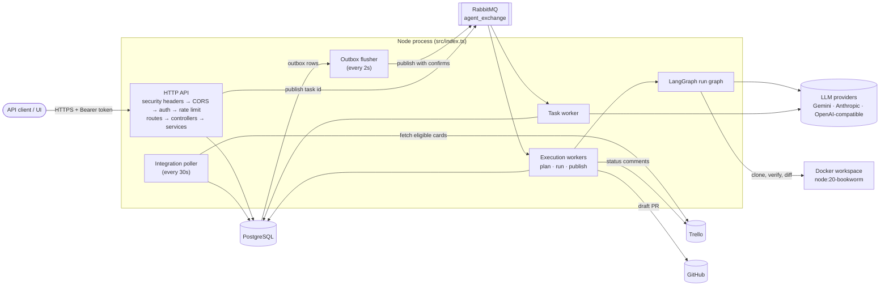
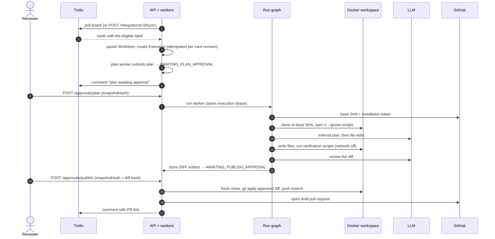
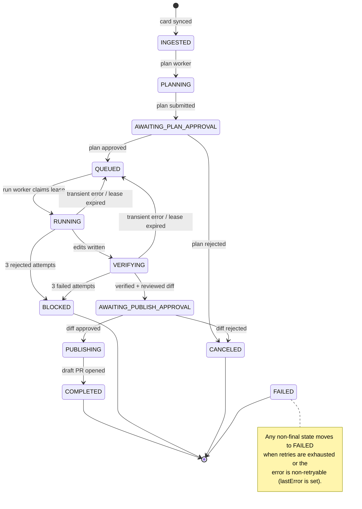
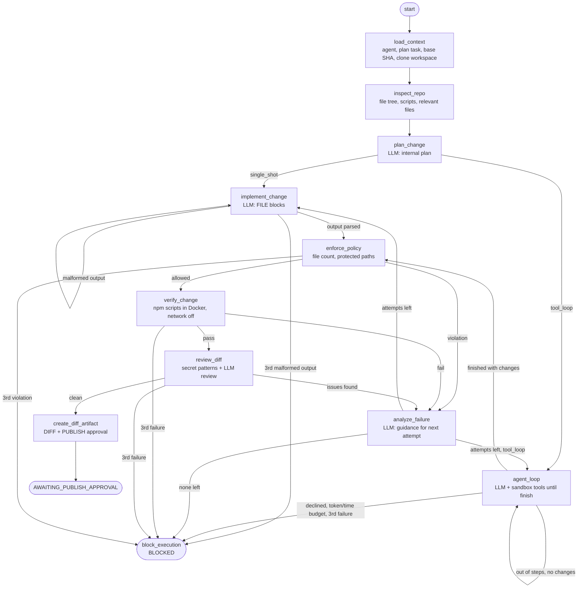
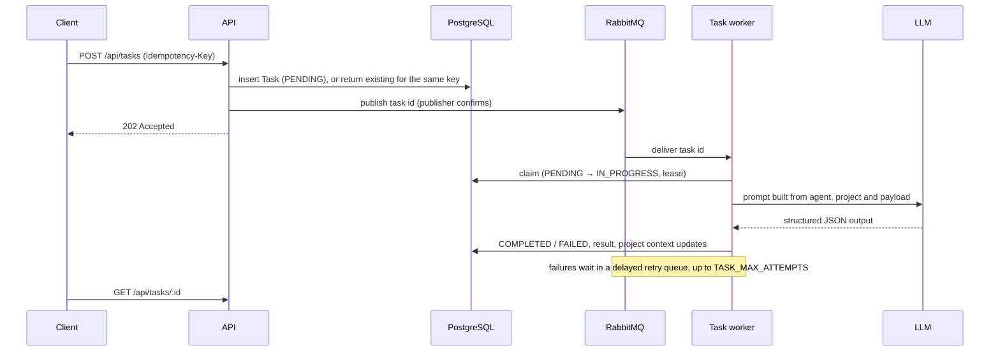
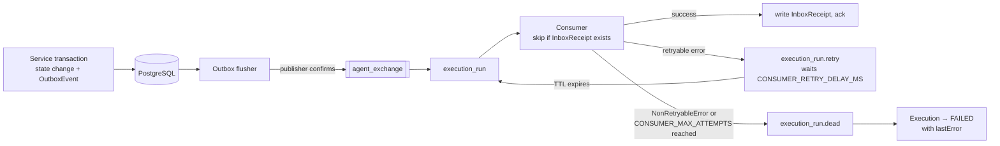
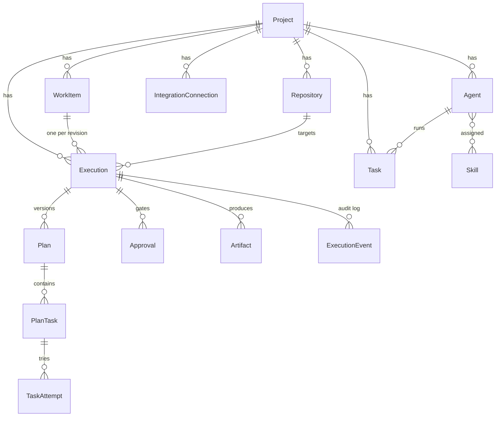

# Agent Orchestration Backend

Express/TypeScript backend that turns tickets into reviewed code changes. An AI agent picks up a bug card from Trello, plans the fix, edits the code in an isolated Docker workspace, proves it with the repository's own checks, and opens a **draft** GitHub pull request. A human approves both the plan and the exact diff before anything is pushed.

It also runs a simpler general-purpose pipeline: queue a task for an LLM agent and get structured output back.

Built on PostgreSQL + Prisma, RabbitMQ, LangGraph, and pluggable LLM providers (Gemini, Anthropic, and any OpenAI-compatible API by configuration).

## Contents

- [Quick start](#quick-start)
- [Architecture](#architecture)
- [How the Trello → pull request workflow runs](#how-the-trello--pull-request-workflow-runs)
- [Task pipeline](#task-pipeline)
- [Reliable messaging](#reliable-messaging)
- [Data model](#data-model)
- [Security model](#security-model)
- [Setting up the Trello → GitHub workflow](#setting-up-the-trello--github-workflow)
- [API reference](#api-reference)
- [Configuration](#configuration)
- [Testing](#testing)
- [Troubleshooting](#troubleshooting)
- [Project structure](#project-structure)
- [Known limits](#known-limits)
- [Project docs](#project-docs)

## Quick start

Requirements: Node.js 20 LTS or newer, and Docker Desktop with Compose.

```powershell
Copy-Item .env.example .env.local
# Set ENCRYPTION_KEY (64 hex chars) and provider credentials in .env.local.
# Either set API_AUTH_TOKEN, or AUTH_DISABLED=true for local-only development.
docker-compose up -d            # Postgres on :15432, RabbitMQ on :15673 (UI on :25672)
npm install
npm run prisma:migrate:local
npm run dev:local               # API on http://localhost:3001
```

Check it is up:

```powershell
curl.exe http://localhost:3001/health
# {"status":"healthy","checks":{"database":"ok","rabbitmq":"ok"}}
```

If your database was created earlier with `prisma db push`, `prisma migrate dev` will offer to reset it, which deletes all data. Don't accept. If the schema already matches the init migration, baseline it instead:

```powershell
npx dotenv -e .env.local -- npx prisma migrate resolve --applied 20260620000000_init
npx dotenv -e .env.local -- npx prisma migrate deploy
```

Use migrations (not `db push`) from then on.

## Architecture

One Node process serves the HTTP API and runs the background workers. Work is handed between them through RabbitMQ, and every state change is stored in PostgreSQL first.



| Component | Where | Role |
| --- | --- | --- |
| HTTP API | `src/routes`, `src/controllers`, `src/middleware` | Validates requests with Zod, delegates to services, formats errors via `AppError` |
| Execution state machine | `src/services/executionService.ts` | Creates executions, submits plans, decides approvals; writes outbox events in the same transaction |
| Outbox flusher | `src/services/outboxService.ts` | Publishes pending `OutboxEvent` rows to RabbitMQ |
| Execution workers | `src/services/executionWorker.ts` | Consume `execution.plan`, `execution.run`, `execution.publish`; deduplicate with `InboxReceipt`; hold run leases |
| Run graph | `src/services/agentGraph/` | LangGraph state machine that plans, edits, verifies and reviews a change |
| Workspace | `src/services/workspaceService.ts` | Docker clone, verification, diff, and publish-from-fresh-clone |
| Issue trackers | `src/integrations/trackerRegistry.ts` | Pluggable `IssueTrackerAdapter`s; Trello is the only one |
| Source control | `src/integrations/githubApp.ts` | GitHub App auth, base SHA, draft pull requests |
| LLM layer | `src/services/llm/` | Provider routing, output checks, rate-limit retries |
| Task pipeline | `src/services/taskQueueService.ts`, `agentRunner.ts` | General LLM tasks with retries and leases |

If RabbitMQ is unavailable at startup in non-production, the API still starts in degraded mode (`/health` reports it).

### Where output is written on disk

The two pipelines write to different folders. All three are gitignored.

| Folder | Pipeline | What's in it |
| --- | --- | --- |
| `generated-code/<project>/` | Task pipeline | Files from an agent's `FILE` blocks in a task reply. This is the task's final output. |
| `workspaces/<executionId>/` (`WORKSPACE_ROOT`) | Execution pipeline | A full clone of the target repo where the agent edits files and verification runs. It's a scratch copy, not the output, and is deleted when the run step ends (set `KEEP_WORKSPACES=true` to keep it for debugging). |
| `artifacts/<executionId>.diff` (`ARTIFACT_ROOT`) | Execution pipeline | The exact diff that was verified, reviewed and approved. This is what gets published. |

Publishing never reads `workspaces/`. It clones the repository fresh, applies the `.diff` from `artifacts/`, and pushes, so the PR always contains exactly the approved bytes.

## How the Trello → pull request workflow runs

### End to end



Both approvals must quote the `snapshotHash` of the pending approval, so a reviewer can only approve exactly what they saw. The publish step re-checks that hash against the stored diff and that the base branch has not moved.

### Execution states



- Runs hold a lease (`EXECUTION_LEASE_MS`) renewed by a heartbeat. If a worker dies, a sweep requeues the run once the lease expires.
- Transient failures are retried; a moved base branch, a changed diff, exhausted LLM credits or a long quota wait fail immediately.
- Trello gets a comment on plan, block, failure and PR creation.

### Inside a run

The run step is a LangGraph state graph (`src/services/agentGraph/executionGraph.ts`). Each change gets up to 3 attempts; feedback from a failed attempt is fed into the next one. Every retry starts from a clean checkout of the base commit, so it never builds on a failed attempt's edits.



`EXECUTION_AGENT_MODE` picks how the change is made:

- `single_shot` (default): `implement_change` asks the model once per attempt for whole files.
- `tool_loop`: `agent_loop` gives the model the sandbox tools (`src/services/sandbox/tools.ts`: list, read, search, edit, run a check, finish). It works step by step against a long-lived container with no network, until it calls `finish` or a budget runs out: `AGENT_MAX_STEPS` model calls per attempt (or the execution's `budget.maxSteps`), the execution's `budget.maxTokens` across all attempts, and its `budget.maxDurationSeconds`. The agent can also decline the ticket (`finish` with status `blocked`), which blocks the execution without retrying. Older tool output is shortened as the conversation grows. Each model call is a `GRAPH_AGENT_STEP` event and each tool call a `ToolCall` row, so a run can be replayed.

In both modes, policy, verification and review run afterwards, independently of what the agent reports.

#### Token limits

Every model call, from either pipeline, is recorded in the `LlmUsage` table with its tokens and what it was for (`plan.v1`, `agent.v2`, `task`, ...). Two limits are checked before each call:

- **Per execution:** `budget.maxTokens` on the execution (set from `EXECUTION_MAX_TOKENS` when it is created, default 200,000) covers all of its calls: plan, loop, review and failure analysis.
- **Per day, across everything:** `LLM_DAILY_TOKEN_LIMIT` (default 2,000,000 per UTC day, `0` to switch off). Once reached, new calls fail with a `TokenLimitError` that is not retried, and the execution fails with the reason. `GET /api/llm/usage/today` returns `{ used, limit, resetsAt }`.

A call that has started always finishes, so a limit can be passed by one call.

The LLM steps' prompts are versioned files in `src/prompts/execution/` (e.g. `implement.v1.md`). Each has a system part (fixed instructions) and a user part (ticket details). The active versions are listed in `src/prompts/index.ts`, and each run records them in its execution events (`promptVersions`, `promptVersion`). To change wording, add a new version instead of editing a released one.

The agent returns whole files in this format inside a JSON `actions` string; anything else is rejected and retried:

````text
FILE: src/pricing.js
```js
...complete new file content...
```
````

## Task pipeline

The original, general-purpose pipeline: run one LLM agent on a payload and store its structured result.



Generated files are written only under `generated-code/<project>/`, with file-count and size limits. A periodic sweep re-queues pending tasks and expired leases.

## Reliable messaging

Execution state changes are never published straight to RabbitMQ. They are written as `OutboxEvent` rows in the same database transaction, then flushed. Consumers record an `InboxReceipt` per message, so a redelivered message is processed once.



The same pattern applies to `execution_plan` and `execution_publish`. Inspect the `*.dead` queues in the RabbitMQ management UI (`http://localhost:25672`). In code, throw `NonRetryableError` (`src/utils/safeError.ts`) for failures that will not succeed on retry.

## Data model

Core entities (see `prisma/schema.prisma` for every field):



`OutboxEvent` and `InboxReceipt` stand alone and back the messaging guarantees above. An execution's idempotency key is `workItemId:revisionHash`, so re-syncing an unchanged card never creates a second execution.

## Security model

**API access**
- All `/api/*` routes require `Authorization: Bearer <API_AUTH_TOKEN>`. Auth is skipped only when `AUTH_DISABLED=true` is set explicitly (refused in production); otherwise missing tokens get `401`.
- `GET /health` is intentionally unauthenticated for platform probes.
- Browsers are allowed only from origins in `CORS_ORIGINS`; an empty list blocks all browser origins.
- Production refuses to start without `API_AUTH_TOKEN`, `CORS_ORIGINS`, `DATABASE_URL` and `ENCRYPTION_KEY`.

**Secrets**
- Agent `config.apiKey` and integration credentials are encrypted at rest (`ENCRYPTION_KEY`) and redacted from API responses.
- Logged errors omit query strings and headers (`describeError()`), so provider keys and tokens are not written to logs.
- Raw LLM output is not stored unless `STORE_RAW_LLM_OUTPUT=true`.

**Repository execution**
- Verification runs in `node:20-bookworm` with `--network none`, CPU/memory/PID limits, and `npm ci --ignore-scripts`.
- Generated file writes reject `.git` paths and any path through a symlink.
- Diff review rejects added secrets (GitHub, OpenAI, AWS, Google, Slack tokens, credentials in URLs).
- Publishing never pushes the verification workspace: it clones fresh at the recorded base SHA, applies only the approved diff, and commits and pushes with git hooks disabled.
- The GitHub token travels as an HTTP header from the container's environment. It never appears in `.git/config` or on the docker command line.
- Only **draft** pull requests are created. Nothing is merged or deployed.

**Outbound HTTP**
- HTTP connector calls are denied unless the hostname is in `MCP_HTTP_ALLOWED_HOSTS`. Redirects and URL credentials are rejected. Private IPs also need `MCP_HTTP_ALLOW_PRIVATE_IPS=true`.

**LLM output**
- Responses that hit `LLM_MAX_OUTPUT_TOKENS`, are blocked, or are empty raise an error instead of being parsed as partial output.

## Setting up the Trello → GitHub workflow

1. **GitHub App**: create one with *Contents* and *Pull requests* read/write, install it on the target repository, and set `GITHUB_APP_ID` and `GITHUB_APP_PRIVATE_KEY` (PEM on one line with `\n`).
2. **Repository record**: `POST /api/repositories` with owner, name, installation ID and `verificationConfig`, e.g. `{ "scripts": ["lint", "build", "test"] }` (scripts must exist in that repo).
3. **Trello integration**: `POST /api/integrations` with `type: "TRELLO"` and config `apiKey`, `token`, `boardId`, `eligibleLabel`, `repositoryId`.
4. **Agent**: `POST /api/agents` in the same project with `provider`, `model` and `config.apiKey`. The run uses the project's first agent.
5. Label a card, then wait for the poller or call `POST /api/integrations/:id/sync`.
6. Approve the plan and then the diff:

```json
{ "approved": true, "snapshotHash": "<64-char hex from the pending approval>", "comment": "optional" }
```

Take `snapshotHash` from the pending approval in `GET /api/executions/:id`. A mismatched hash, or an approval that was already decided, returns `409`.

Docker Desktop must be running before an approved plan can execute. The workflow supports Node/TypeScript repositories.

## API reference

All routes are under `/api` and require the bearer token.

| Area | Endpoints |
| --- | --- |
| Projects | `POST/GET /projects`, `GET/PATCH/DELETE /projects/:id` |
| Agents | `POST/GET /agents`, `GET/PUT/DELETE /agents/:id` |
| Skills | `POST/GET /skills`, `GET/PUT/DELETE /skills/:id`, `POST /skills/assign` |
| Tasks | `POST /tasks` (202, `Idempotency-Key`), `GET /tasks`, `GET /tasks/:id` |
| LLM | `GET /llm/providers`, `POST /llm/discover`, `GET /llm/models` (`X-Provider-Api-Key`), `GET /llm/usage`, `GET /llm/usage/today` (tokens used today against `LLM_DAILY_TOKEN_LIMIT`) |
| Repositories | `POST/GET /repositories` |
| Integrations | `POST/GET /integrations`, `POST /integrations/:id/sync` |
| Work items | `GET /work-items`, `GET /work-items/:id` |
| Executions | `POST/GET /executions`, `GET /executions/:id`, `POST /executions/:id/plans`, `POST /executions/:id/approvals/plan\|publish` |

Behaviour worth knowing:
- Task creation returns `202 Accepted`; execution is asynchronous. Send a stable `Idempotency-Key` so client retries don't duplicate work.
- `POST /llm/discover` takes temporary credentials in the body; `GET /llm/models` takes them in `X-Provider-Api-Key`, never the URL.
- `/llm/usage` returns `501` when the provider has no safe usage API. It never runs paid inference as a probe.
- Syncing an integration that is not an issue tracker (e.g. `GITHUB`) returns `400`.

## Configuration

`.env.example` is the template; `.env.local` (Docker) and `.env.cloud` (Prisma Accelerate) are loaded by the `dev:*` scripts.

| Group | Variables |
| --- | --- |
| Core | `NODE_ENV`, `PORT`, `DATABASE_URL`, `RABBITMQ_URL`, `ENCRYPTION_KEY` |
| API access | `API_AUTH_TOKEN`, `API_AUTH_ACTOR`, `AUTH_DISABLED`, `CORS_ORIGINS`, `API_RATE_LIMIT_PER_MINUTE` |
| LLM | `GEMINI_API_KEY`, `OPENAI_API_KEY`, `OPENAI_BASE_URL`, `ANTHROPIC_API_KEY`, `LLM_PROVIDERS`, `LLM_DEFAULT_PROVIDER`, `LLM_DEFAULT_MODEL`, `LLM_DAILY_TOKEN_LIMIT`, `LLM_REQUEST_TIMEOUT_MS`, `LLM_MAX_OUTPUT_TOKENS`, `LLM_RATE_LIMIT_RETRIES` |
| Task pipeline | `TASK_MAX_ATTEMPTS`, `TASK_RETRY_DELAY_MS`, `TASK_LEASE_MS`, `GENERATED_CODE_MAX_FILES`, `GENERATED_CODE_MAX_FILE_BYTES`, `STORE_RAW_LLM_OUTPUT` |
| Execution pipeline | `GITHUB_APP_ID`, `GITHUB_APP_PRIVATE_KEY`, `INTEGRATION_POLL_INTERVAL_MS`, `EXECUTION_LEASE_MS`, `EXECUTION_AGENT_MODE`, `AGENT_MAX_STEPS`, `EXECUTION_MAX_TOKENS`, `EXECUTION_MAX_DURATION_SECONDS`, `WORKSPACE_ROOT`, `KEEP_WORKSPACES`, `ARTIFACT_ROOT` |
| Messaging | `CONSUMER_MAX_ATTEMPTS`, `CONSUMER_RETRY_DELAY_MS` |
| HTTP connector | `MCP_HTTP_ALLOWED_HOSTS`, `MCP_HTTP_ALLOW_PRIVATE_IPS`, `MCP_HTTP_TIMEOUT_MS`, `MCP_HTTP_MAX_RESPONSE_BYTES` |

Defaults and comments are in `.env.example`; `src/config.ts` is the single place they are read.

### Adding an LLM provider

Built in: `gemini` and `anthropic` (native APIs) and `openai`. Any other API that speaks OpenAI's `/models` and `/chat/completions` format (Groq, Mistral, DeepSeek, xAI, Together, Fireworks, OpenRouter, a LiteLLM proxy, or local Ollama / vLLM / LM Studio) is added with configuration only, as a profile in `LLM_PROVIDERS`:

```bash
LLM_PROVIDERS='[
  {"key": "groq", "label": "Groq", "baseUrl": "https://api.groq.com/openai/v1", "apiKeyEnv": "GROQ_API_KEY", "supportsTools": true},
  {"key": "ollama", "baseUrl": "http://localhost:11434/v1"}
]'
GROQ_API_KEY=...
```

Agents then use `"provider": "groq"` with a `model` the endpoint offers (`GET /api/llm/models?provider=groq`). `GET /api/llm/providers` lists every configured provider.

| Field | Meaning |
| --- | --- |
| `key` | Name agents use; lowercase letters, digits, dashes; must not clash with a built-in |
| `baseUrl` | API root. `https` only; `http` is allowed for `localhost` outside production |
| `apiKeyEnv` | Environment variable holding the server's key. Omit for keyless local servers or when each agent sets `config.apiKey` |
| `supportsTools` | Whether the endpoint supports tool calling (default `false`) |
| `modelPrefixes` | Optional: list only models whose id starts with one of these |
| `label` | Optional display name used in errors and model lists |

The server refuses to start if a profile is invalid (bad URL, duplicate key, `apiKeyEnv` not set). Base URLs come only from this configuration: an agent chooses a provider key, never a host, so it cannot make the server send a key elsewhere.

An agent without a `provider` uses `LLM_DEFAULT_PROVIDER` and `LLM_DEFAULT_MODEL` (default `gemini` / `gemini-flash-latest`); an agent with a provider but no model fails with a clear error. APIs with their own format (e.g. AWS Bedrock, Vertex AI) still need a native provider class in `src/services/llm/providers/`.

## Testing

| Command | Purpose |
| --- | --- |
| `npm run lint` | ESLint |
| `npm test` | Build, then unit tests (`node:test` against compiled `dist/`) |
| `npm run verify` | Lint + unit tests |
| `npm run test:e2e` | End-to-end suites against a running server |
| `npm run test:e2e:smoke` | Only the credential-free smoke suite |
| `npm run eval:coding` | Coding benchmark: how well the agent fixes real bugs (see below) |

Run a single unit test file with `npm run build && node --test tests/auditFixes.test.js`. New test files must be added to the `test` script in `package.json`.

### End-to-end tests

`tests/e2e/` drives a **running** server over HTTP (start it with `npm run dev:local` first). Copy `.env.e2e.example` to `.env.e2e` and fill in what you have. Each suite skips itself, naming the missing variables, until its credentials are set:

| Suite | Needs | Covers |
| --- | --- | --- |
| `smoke` | server only | health, auth, validation, 404s, project lifecycle, non-tracker sync refused |
| `taskPipeline` | `E2E_LLM_*` | agent key redaction, `Idempotency-Key`, queued task runs to `COMPLETED` |
| `executionPipeline` | `E2E_LLM_*`, `E2E_TRELLO_*`, `E2E_GITHUB_*` (server also needs the GitHub App and Docker) | Trello card → sync → plan approval (stale hash rejected) → run → diff bound to publish approval → draft PR → Trello comment |

The execution suite creates a real Trello card and, unless `E2E_PUBLISH=false`, opens a draft PR, so point it at a throwaway repository. It deletes the card afterwards and, when `E2E_GITHUB_TOKEN` is set, closes the PR and deletes the branch (`E2E_KEEP_RESOURCES=true` keeps them). It reuses one `e2e-execution-pipeline` project between runs.

### Coding benchmark

The e2e suites prove the plumbing works; the benchmark measures whether the agent writes **correct** code. `tests/e2e/coding-scenarios/` holds a small clean JS project (`repo/`) and 8 scenarios, each with a ticket, the files that plant its bug, and a **hidden test** that never leaves this repository:

| # | Scenario | Measures |
| --- | --- | --- |
| 01 | Off-by-one in pagination | Basic single-file fix |
| 02 | Order total rounded down | Numeric edge cases |
| 03 | `slugify` breaks on accents and padding | Edge-case handling |
| 04 | Missing `await` | Async reasoning |
| 05 | Currency ignored by invoice and money helper | Multi-file change |
| 06 | Vague "contacts missing after import" ticket | Finding the right file |
| 07 | Bug in a 30 KB file | The 20 KB context cut-off |
| 08 | Impossible "send invoices to LegacyBill" ticket | Should end `BLOCKED` |

Per run, the runner points the sandbox repo's `main` at the scenario's code, creates the Trello card, approves the plan, waits for a diff or `BLOCKED`, **rejects publishing** (no PR is opened), and grades the diff in a network-less Docker container: the repo's own tests, then the hidden test. Outcomes are *correct fix*, *wrong fix shipped* (a PR would have been opened but the hidden test fails, which is the key number), *correctly blocked*, *no fix* and *infrastructure failure*. It writes `docs/testing/coding-eval-<date>.md`, prints a row for the roadmap's results log, and restores `main` to the clean project.

```bash
npm run eval:coding -- --check            # setup check, no LLM calls
npm run eval:coding -- --scenario 01      # one scenario
npm run eval:coding -- --runs 3           # every scenario, 3 runs each
```

It needs the execution suite's variables plus `E2E_GITHUB_TOKEN` (Contents read/write on the sandbox repo), the server and Docker on the same machine (it reads the diff artifact from disk), and **it rewrites the sandbox repo's `main`**. `npm test` includes `tests/codingScenarios.test.js`, which checks every scenario is fair: the clean project passes everything, and each bug passes the repo's tests but fails its hidden test.

## Troubleshooting

| Symptom | Cause and fix |
| --- | --- |
| `prisma migrate dev` wants to reset the `public` schema | The DB was created with `db push`. Baseline it (see [Quick start](#quick-start)); don't reset. |
| `/health` shows `rabbitmq: error` | Compose isn't running, or another service holds the port. `docker-compose up -d`; AMQP is remapped to `15673` to avoid Windows conflicts. |
| Every request returns `401` | No `API_AUTH_TOKEN` configured. Set it, or `AUTH_DISABLED=true` locally. |
| Execution `FAILED` with a Docker error | Docker Desktop isn't running, or the image pull failed. The error includes the exit code and stderr/stdout tails. |
| Execution `FAILED` with an LLM `429` | Rate limit or quota. Short limits are retried automatically; "no credits" or a daily free-tier quota fail fast. Add credits, wait for the reset, or switch model (free-tier quotas are per model). |
| Execution `BLOCKED` | Three attempts failed verification or review. `GET /api/executions/:id` shows each attempt's error and the events. |
| Approval returns `409` | The `snapshotHash` is stale or the approval was already decided. Re-read the execution and use the pending approval's hash. |
| A message never seems to run | Check the `*.dead` queues in the RabbitMQ UI and the execution's `lastError`. |

## Project structure

```text
src/
  index.ts              app wiring, background loops, graceful shutdown
  config.ts             all env-derived settings
  db.ts                 Prisma client (driver adapter or Accelerate)
  routes/ controllers/  HTTP layer
  middleware/           auth, CORS errors, rate limit, validation, error handler
  schemas/              Zod request schemas
  prompts/              versioned run-graph prompts (execution/*.vN.md) + loader
  services/
    executionService.ts     execution state machine + approvals
    executionWorker.ts      plan/run/publish consumers, leases, recovery
    outboxService.ts        transactional outbox flusher
    ingestionService.ts     tracker-neutral ticket ingestion
    integrationPollingService.ts
    workspaceService.ts     Docker clone/verify/diff/publish, long-lived run sandbox
    agentGraph/             LangGraph run graph, agent loop, repo context, repo policy, diff review
    llm/                    provider registry, providers, tool calling, retries, output errors
    sandbox/                agent tools (list/read/search/edit/run_check/finish) with policy + ToolCall recording
    taskQueueService.ts, agentRunner.ts, promptBuilder.ts   task pipeline
    rabbitMQService.ts      connection, subscribe with retry/dead-letter
  integrations/         tracker adapters + registry, GitHub App
  utils/                code writer, safe paths, crypto, safe errors, LLM output parsing
prisma/                 schema and committed migrations
tests/                  unit tests (against dist/) and tests/e2e/
docs/                   plans, specs, testing, guides, history

# created at runtime (gitignored)
generated-code/         task pipeline output
workspaces/             execution scratch clones, deleted after each run step
artifacts/              approved diffs, one per execution
```

## Known limits

- **One tracker, one source host.** Trello is the only issue tracker and GitHub the only source control. Trackers are pluggable (`IssueTrackerAdapter`); source control is not yet (AUDIT A2).
- **Node/TypeScript repositories only for now**, verified through their npm scripts. Support for any language, framework and platform is the next phase (Phase 4 of `docs/plans/AGENTIC_ROADMAP.md`).
- **Repository context is selected by file name.** The agent sees up to 12 files whose paths match ticket words, each cut at 20 KB, and returns whole files. Vague tickets and very large files are weak spots.
- **The agent can modify existing tests.** The coding benchmark's hidden tests catch this when measuring; nothing blocks it in a normal run yet (Phase 2 of `docs/plans/AGENTIC_ROADMAP.md`).
- **One HTTP connector**, not a full Model Context Protocol transport. Skills and MCP resources are stored and assignable but not yet included in prompts.
- **Process-local** rate limiting and logs. Multi-instance deployments need a shared limiter (e.g. Redis), centralized logs, metrics and tracing.

## Project docs

- `AUDIT.md`: audit findings and fix-progress tracker.
- `docs/plans/`: roadmaps and project plans.
- `docs/specs/`: technical specifications (orchestration engine, LangGraph, provider infrastructure).
- `docs/testing/`: unit and end-to-end test plans.
- `docs/guides/`: Prisma and TypeScript guides.
- `docs/history/`: earlier phase plans and walkthroughs.

Planning docs describe intent and past phases; the code and this README describe current behaviour.
