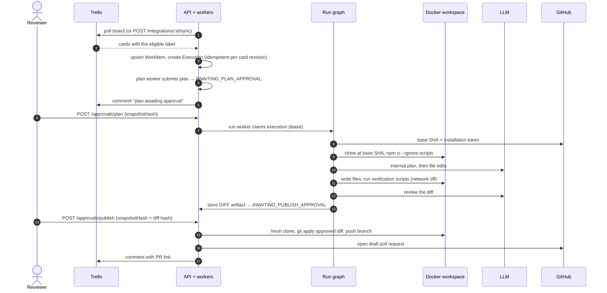
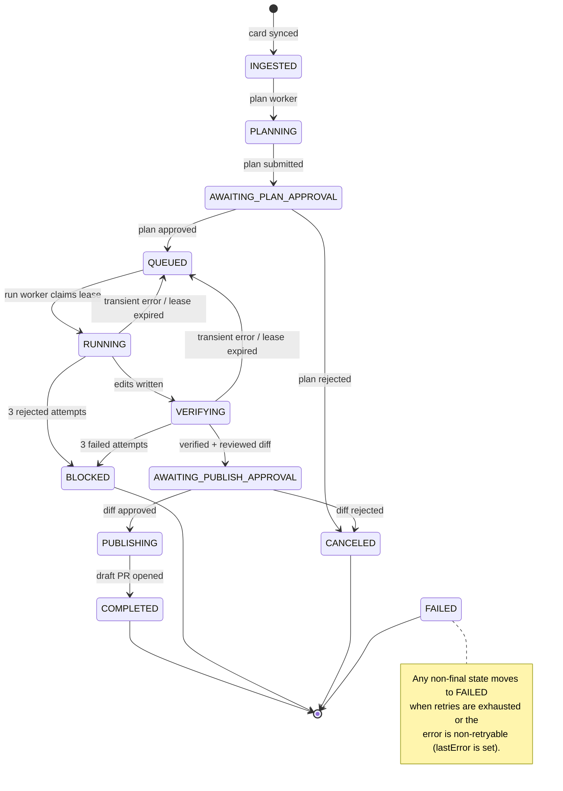
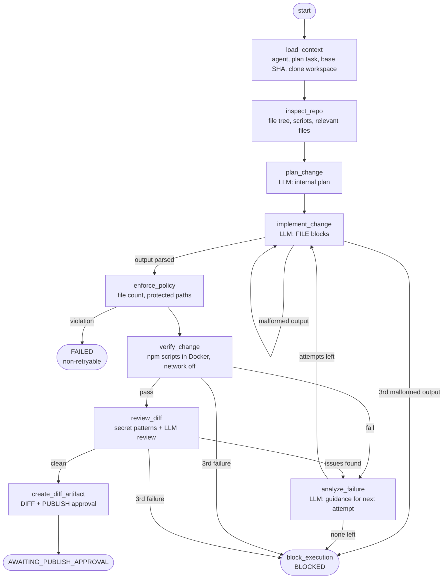
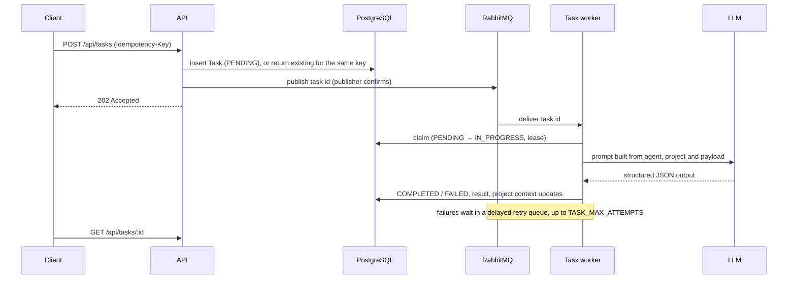
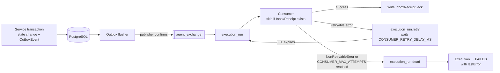
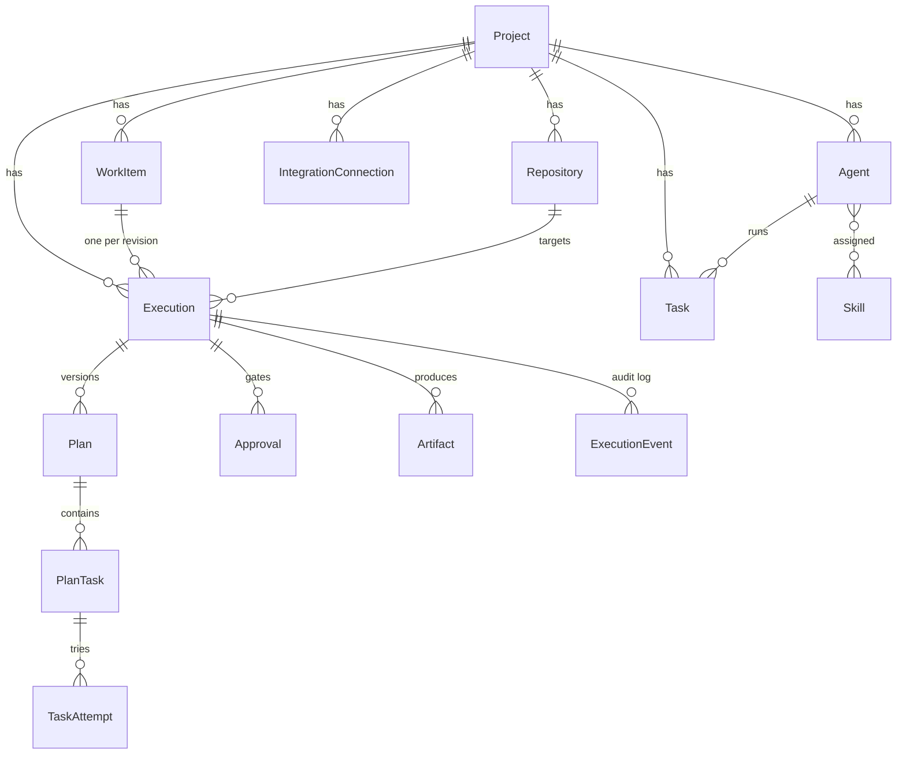

# Agent Orchestration Backend

Express/TypeScript backend that turns tickets into reviewed code changes. An AI agent picks up a bug card from Trello, plans the fix, edits the code in an isolated Docker workspace, proves it with the repository's own checks, and opens a **draft** GitHub pull request. A human approves both the plan and the exact diff before anything is pushed.

It also runs a simpler general-purpose pipeline: queue a task for an LLM agent and get structured output back.

Built on PostgreSQL + Prisma, RabbitMQ, LangGraph, and pluggable LLM providers (Gemini, OpenAI, Anthropic).

## Contents

- [Quick start](#quick-start)
- [Architecture](#architecture)
- [How the Trello → pull request workflow runs](#how-the-trello--pull-request-workflow-runs)
- [Task pipeline](#task-pipeline)
- [Reliable messaging](#reliable-messaging)
- [Data model](#data-model)
- [Security model](#security-model)
- [Setting up the Trello → GitHub workflow](#setting-up-the-trello--github-workflow)
- [API reference](#api-reference)
- [Configuration](#configuration)
- [Testing](#testing)
- [Troubleshooting](#troubleshooting)
- [Project structure](#project-structure)
- [Known limits](#known-limits)
- [Project docs](#project-docs)

## Quick start

Requirements: Node.js 20 LTS or newer, and Docker Desktop with Compose.

```powershell
Copy-Item .env.example .env.local
# Set ENCRYPTION_KEY (64 hex chars) and provider credentials in .env.local.
# Either set API_AUTH_TOKEN, or AUTH_DISABLED=true for local-only development.
docker-compose up -d            # Postgres on :15432, RabbitMQ on :15673 (UI on :25672)
npm install
npm run prisma:migrate:local
npm run dev:local               # API on http://localhost:3001
```

Check it is up:

```powershell
curl.exe http://localhost:3001/health
# {"status":"healthy","checks":{"database":"ok","rabbitmq":"ok"}}
```

If your database was created earlier with `prisma db push`, `prisma migrate dev` will offer to reset it, which deletes all data. Don't accept. If the schema already matches the init migration, baseline it instead:

```powershell
npx dotenv -e .env.local -- npx prisma migrate resolve --applied 20260620000000_init
npx dotenv -e .env.local -- npx prisma migrate deploy
```

Use migrations (not `db push`) from then on.

## Architecture

One Node process serves the HTTP API and runs the background workers. Work is handed between them through RabbitMQ, and every state change is stored in PostgreSQL first.


| Component | Where | Role |
| --- | --- | --- |
| HTTP API | `src/routes`, `src/controllers`, `src/middleware` | Validates requests with Zod, delegates to services, formats errors via `AppError` |
| Execution state machine | `src/services/executionService.ts` | Creates executions, submits plans, decides approvals; writes outbox events in the same transaction |
| Outbox flusher | `src/services/outboxService.ts` | Publishes pending `OutboxEvent` rows to RabbitMQ |
| Execution workers | `src/services/executionWorker.ts` | Consume `execution.plan`, `execution.run`, `execution.publish`; deduplicate with `InboxReceipt`; hold run leases |
| Run graph | `src/services/agentGraph/` | LangGraph state machine that plans, edits, verifies and reviews a change |
| Workspace | `src/services/workspaceService.ts` | Docker clone, verification, diff, and publish-from-fresh-clone |
| Issue trackers | `src/integrations/trackerRegistry.ts` | Pluggable `IssueTrackerAdapter`s; Trello is the only one |
| Source control | `src/integrations/githubApp.ts` | GitHub App auth, base SHA, draft pull requests |
| LLM layer | `src/services/llm/` | Provider routing, output checks, rate-limit retries |
| Task pipeline | `src/services/taskQueueService.ts`, `agentRunner.ts` | General LLM tasks with retries and leases |

If RabbitMQ is unavailable at startup in non-production, the API still starts in degraded mode (`/health` reports it).

## How the Trello → pull request workflow runs

### End to end



Both approvals must quote the `snapshotHash` of the pending approval, so a reviewer can only approve exactly what they saw. The publish step re-checks that hash against the stored diff and that the base branch has not moved.

### Execution states



- Runs hold a lease (`EXECUTION_LEASE_MS`) renewed by a heartbeat. If a worker dies, a sweep requeues the run once the lease expires.
- Transient failures are retried; policy violations, a moved base branch, a changed diff, exhausted LLM credits or a long quota wait fail immediately.
- Trello gets a comment on plan, block, failure and PR creation.

### Inside a run

The run step is a LangGraph state graph (`src/services/agentGraph/executionGraph.ts`). Each change gets up to 3 attempts; feedback from a failed attempt is fed into the next one.



The agent returns whole files in this format inside a JSON `actions` string; anything else is rejected and retried:

````text
FILE: src/pricing.js
```js
...complete new file content...
```
````

## Task pipeline

The original, general-purpose pipeline: run one LLM agent on a payload and store its structured result.



Generated files are written only under `generated-code/<project>/`, with file-count and size limits. A periodic sweep re-queues pending tasks and expired leases.

## Reliable messaging

Execution state changes are never published straight to RabbitMQ. They are written as `OutboxEvent` rows in the same database transaction, then flushed. Consumers record an `InboxReceipt` per message, so a redelivered message is processed once.



The same pattern applies to `execution_plan` and `execution_publish`. Inspect the `*.dead` queues in the RabbitMQ management UI (`http://localhost:25672`). In code, throw `NonRetryableError` (`src/utils/safeError.ts`) for failures that will not succeed on retry.

## Data model

Core entities (see `prisma/schema.prisma` for every field):



`OutboxEvent` and `InboxReceipt` stand alone and back the messaging guarantees above. An execution's idempotency key is `workItemId:revisionHash`, so re-syncing an unchanged card never creates a second execution.

## Security model

**API access**
- All `/api/*` routes require `Authorization: Bearer <API_AUTH_TOKEN>`. Auth is skipped only when `AUTH_DISABLED=true` is set explicitly (refused in production); otherwise missing tokens get `401`.
- `GET /health` is intentionally unauthenticated for platform probes.
- Browsers are allowed only from origins in `CORS_ORIGINS`; an empty list blocks all browser origins.
- Production refuses to start without `API_AUTH_TOKEN`, `CORS_ORIGINS`, `DATABASE_URL` and `ENCRYPTION_KEY`.

**Secrets**
- Agent `config.apiKey` and integration credentials are encrypted at rest (`ENCRYPTION_KEY`) and redacted from API responses.
- Logged errors omit query strings and headers (`describeError()`), so provider keys and tokens are not written to logs.
- Raw LLM output is not stored unless `STORE_RAW_LLM_OUTPUT=true`.

**Repository execution**
- Verification runs in `node:20-bookworm` with `--network none`, CPU/memory/PID limits, and `npm ci --ignore-scripts`.
- Generated file writes reject `.git` paths and any path through a symlink.
- Diff review rejects added secrets (GitHub, OpenAI, AWS, Google, Slack tokens, credentials in URLs).
- Publishing never pushes the verification workspace: it clones fresh at the recorded base SHA, applies only the approved diff, and commits and pushes with git hooks disabled.
- The GitHub token travels as an HTTP header from the container's environment. It never appears in `.git/config` or on the docker command line.
- Only **draft** pull requests are created. Nothing is merged or deployed.

**Outbound HTTP**
- HTTP connector calls are denied unless the hostname is in `MCP_HTTP_ALLOWED_HOSTS`. Redirects and URL credentials are rejected. Private IPs also need `MCP_HTTP_ALLOW_PRIVATE_IPS=true`.

**LLM output**
- Responses that hit `LLM_MAX_OUTPUT_TOKENS`, are blocked, or are empty raise an error instead of being parsed as partial output.

## Setting up the Trello → GitHub workflow

1. **GitHub App**: create one with *Contents* and *Pull requests* read/write, install it on the target repository, and set `GITHUB_APP_ID` and `GITHUB_APP_PRIVATE_KEY` (PEM on one line with `\n`).
2. **Repository record**: `POST /api/repositories` with owner, name, installation ID and `verificationConfig`, e.g. `{ "scripts": ["lint", "build", "test"] }` (scripts must exist in that repo).
3. **Trello integration**: `POST /api/integrations` with `type: "TRELLO"` and config `apiKey`, `token`, `boardId`, `eligibleLabel`, `repositoryId`.
4. **Agent**: `POST /api/agents` in the same project with `provider`, `model` and `config.apiKey`. The run uses the project's first agent.
5. Label a card, then wait for the poller or call `POST /api/integrations/:id/sync`.
6. Approve the plan and then the diff:

```json
{ "approved": true, "snapshotHash": "<64-char hex from the pending approval>", "comment": "optional" }
```

Take `snapshotHash` from the pending approval in `GET /api/executions/:id`. A mismatched hash, or an approval that was already decided, returns `409`.

Docker Desktop must be running before an approved plan can execute. The workflow supports Node/TypeScript repositories.

## API reference

All routes are under `/api` and require the bearer token.

| Area | Endpoints |
| --- | --- |
| Projects | `POST/GET /projects`, `GET/PATCH/DELETE /projects/:id` |
| Agents | `POST/GET /agents`, `GET/PUT/DELETE /agents/:id` |
| Skills | `POST/GET /skills`, `GET/PUT/DELETE /skills/:id`, `POST /skills/assign` |
| Tasks | `POST /tasks` (202, `Idempotency-Key`), `GET /tasks`, `GET /tasks/:id` |
| LLM | `GET /llm/providers`, `POST /llm/discover`, `GET /llm/models` (`X-Provider-Api-Key`), `GET /llm/usage` |
| Repositories | `POST/GET /repositories` |
| Integrations | `POST/GET /integrations`, `POST /integrations/:id/sync` |
| Work items | `GET /work-items`, `GET /work-items/:id` |
| Executions | `POST/GET /executions`, `GET /executions/:id`, `POST /executions/:id/plans`, `POST /executions/:id/approvals/plan\|publish` |

Behaviour worth knowing:
- Task creation returns `202 Accepted`; execution is asynchronous. Send a stable `Idempotency-Key` so client retries don't duplicate work.
- `POST /llm/discover` takes temporary credentials in the body; `GET /llm/models` takes them in `X-Provider-Api-Key`, never the URL.
- `/llm/usage` returns `501` when the provider has no safe usage API. It never runs paid inference as a probe.
- Syncing an integration that is not an issue tracker (e.g. `GITHUB`) returns `400`.

## Configuration

`.env.example` is the template; `.env.local` (Docker) and `.env.cloud` (Prisma Accelerate) are loaded by the `dev:*` scripts.

| Group | Variables |
| --- | --- |
| Core | `NODE_ENV`, `PORT`, `DATABASE_URL`, `RABBITMQ_URL`, `ENCRYPTION_KEY` |
| API access | `API_AUTH_TOKEN`, `API_AUTH_ACTOR`, `AUTH_DISABLED`, `CORS_ORIGINS`, `API_RATE_LIMIT_PER_MINUTE` |
| LLM | `GEMINI_API_KEY`, `OPENAI_API_KEY`, `OPENAI_BASE_URL`, `ANTHROPIC_API_KEY`, `LLM_REQUEST_TIMEOUT_MS`, `LLM_MAX_OUTPUT_TOKENS`, `LLM_RATE_LIMIT_RETRIES` |
| Task pipeline | `TASK_MAX_ATTEMPTS`, `TASK_RETRY_DELAY_MS`, `TASK_LEASE_MS`, `GENERATED_CODE_MAX_FILES`, `GENERATED_CODE_MAX_FILE_BYTES`, `STORE_RAW_LLM_OUTPUT` |
| Execution pipeline | `GITHUB_APP_ID`, `GITHUB_APP_PRIVATE_KEY`, `INTEGRATION_POLL_INTERVAL_MS`, `EXECUTION_LEASE_MS`, `WORKSPACE_ROOT`, `ARTIFACT_ROOT` |
| Messaging | `CONSUMER_MAX_ATTEMPTS`, `CONSUMER_RETRY_DELAY_MS` |
| HTTP connector | `MCP_HTTP_ALLOWED_HOSTS`, `MCP_HTTP_ALLOW_PRIVATE_IPS`, `MCP_HTTP_TIMEOUT_MS`, `MCP_HTTP_MAX_RESPONSE_BYTES` |

Defaults and comments are in `.env.example`; `src/config.ts` is the single place they are read.

## Testing

| Command | Purpose |
| --- | --- |
| `npm run lint` | ESLint |
| `npm test` | Build, then unit tests (`node:test` against compiled `dist/`) |
| `npm run verify` | Lint + unit tests |
| `npm run test:e2e` | End-to-end suites against a running server |
| `npm run test:e2e:smoke` | Only the credential-free smoke suite |

Run a single unit test file with `npm run build && node --test tests/auditFixes.test.js`. New test files must be added to the `test` script in `package.json`.

### End-to-end tests

`tests/e2e/` drives a **running** server over HTTP (start it with `npm run dev:local` first). Copy `.env.e2e.example` to `.env.e2e` and fill in what you have. Each suite skips itself, naming the missing variables, until its credentials are set:

| Suite | Needs | Covers |
| --- | --- | --- |
| `smoke` | server only | health, auth, validation, 404s, project lifecycle, non-tracker sync refused |
| `taskPipeline` | `E2E_LLM_*` | agent key redaction, `Idempotency-Key`, queued task runs to `COMPLETED` |
| `executionPipeline` | `E2E_LLM_*`, `E2E_TRELLO_*`, `E2E_GITHUB_*` (server also needs the GitHub App and Docker) | Trello card → sync → plan approval (stale hash rejected) → run → diff bound to publish approval → draft PR → Trello comment |

The execution suite creates a real Trello card and, unless `E2E_PUBLISH=false`, opens a draft PR, so point it at a throwaway repository. It deletes the card afterwards and, when `E2E_GITHUB_TOKEN` is set, closes the PR and deletes the branch (`E2E_KEEP_RESOURCES=true` keeps them). It reuses one `e2e-execution-pipeline` project between runs.

## Troubleshooting

| Symptom | Cause and fix |
| --- | --- |
| `prisma migrate dev` wants to reset the `public` schema | The DB was created with `db push`. Baseline it (see [Quick start](#quick-start)); don't reset. |
| `/health` shows `rabbitmq: error` | Compose isn't running, or another service holds the port. `docker-compose up -d`; AMQP is remapped to `15673` to avoid Windows conflicts. |
| Every request returns `401` | No `API_AUTH_TOKEN` configured. Set it, or `AUTH_DISABLED=true` locally. |
| Execution `FAILED` with a Docker error | Docker Desktop isn't running, or the image pull failed. The error includes the exit code and stderr/stdout tails. |
| Execution `FAILED` with an LLM `429` | Rate limit or quota. Short limits are retried automatically; "no credits" or a daily free-tier quota fail fast. Add credits, wait for the reset, or switch model (free-tier quotas are per model). |
| Execution `BLOCKED` | Three attempts failed verification or review. `GET /api/executions/:id` shows each attempt's error and the events. |
| Approval returns `409` | The `snapshotHash` is stale or the approval was already decided. Re-read the execution and use the pending approval's hash. |
| A message never seems to run | Check the `*.dead` queues in the RabbitMQ UI and the execution's `lastError`. |

## Project structure

```text
src/
  index.ts              app wiring, background loops, graceful shutdown
  config.ts             all env-derived settings
  db.ts                 Prisma client (driver adapter or Accelerate)
  routes/ controllers/  HTTP layer
  middleware/           auth, CORS errors, rate limit, validation, error handler
  schemas/              Zod request schemas
  services/
    executionService.ts     execution state machine + approvals
    executionWorker.ts      plan/run/publish consumers, leases, recovery
    outboxService.ts        transactional outbox flusher
    ingestionService.ts     tracker-neutral ticket ingestion
    integrationPollingService.ts
    workspaceService.ts     Docker clone/verify/diff/publish
    agentGraph/             LangGraph run graph, repo context, diff review
    llm/                    providers, retries, output errors
    taskQueueService.ts, agentRunner.ts, promptBuilder.ts   task pipeline
    rabbitMQService.ts      connection, subscribe with retry/dead-letter
  integrations/         tracker adapters + registry, GitHub App
  utils/                code writer, crypto, safe errors, LLM output parsing
prisma/                 schema and committed migrations
tests/                  unit tests (against dist/) and tests/e2e/
docs/                   plans, specs, testing, guides, history
```

## Known limits

- **One tracker, one source host.** Trello is the only issue tracker and GitHub the only source control. Trackers are pluggable (`IssueTrackerAdapter`); source control is not yet (AUDIT A2).
- **Node/TypeScript repositories only**, verified through their npm scripts.
- **Repository context is selected by file name.** The agent sees up to 12 files whose paths match ticket words, each cut at 20 KB, and returns whole files. Vague tickets and very large files are weak spots.
- **The agent can modify existing tests.** Hidden acceptance tests are the planned guard (see the coding evaluation plan).
- **One HTTP connector**, not a full Model Context Protocol transport. Skills and MCP resources are stored and assignable but not yet included in prompts.
- **Process-local** rate limiting and logs. Multi-instance deployments need a shared limiter (e.g. Redis), centralized logs, metrics and tracing.

## Project docs

- `AUDIT.md`: audit findings and fix-progress tracker.
- `docs/plans/`: roadmaps and project plans.
- `docs/specs/`: technical specifications (orchestration engine, LangGraph, provider infrastructure).
- `docs/testing/`: unit and end-to-end test plans.
- `docs/guides/`: Prisma and TypeScript guides.
- `docs/history/`: earlier phase plans and walkthroughs.

Planning docs describe intent and past phases; the code and this README describe current behaviour.
