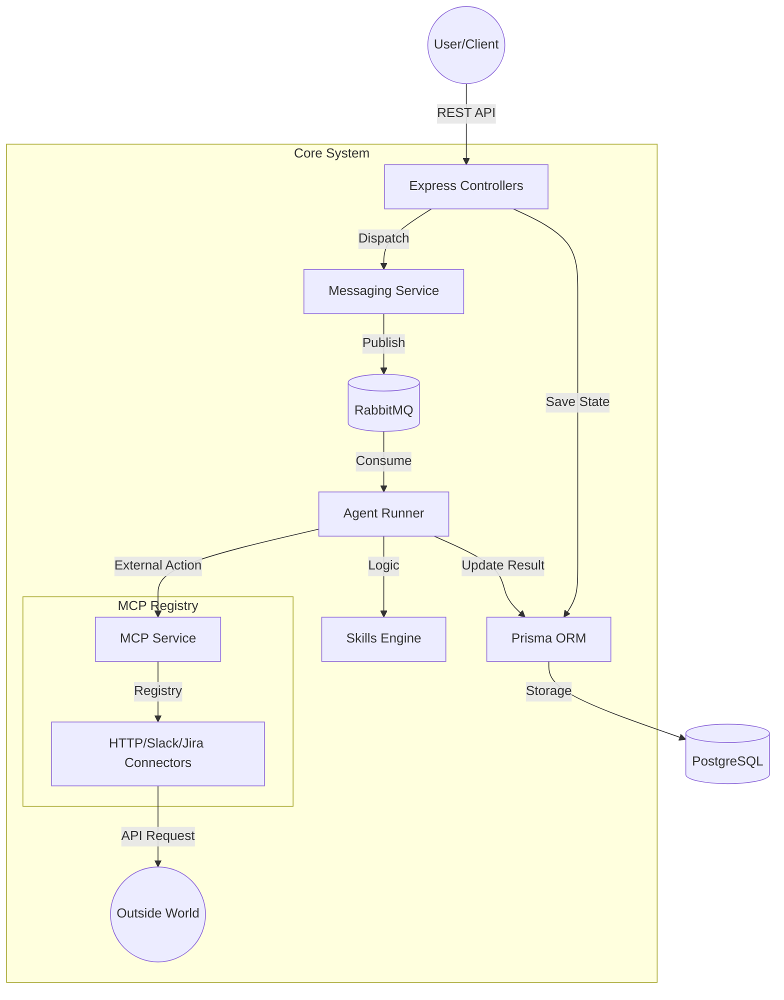

# Agent Orchestration Backend

A robust, modern backend architecture designed for building and orchestrating autonomous AI agents using a message-driven approach.

---

## 🚀 Key Features

*   **Message-Driven Architecture**: Fully integrated with **RabbitMQ** for reliable, asynchronous inter-agent communication.
*   **Pluggable MCP Service**: A "Model Context Protocol" implementation that uses a connector registry pattern. Easily add new external tools (HTTP, Slack, GitHub, etc.) without touching core logic.
*   **Hybrid Database System**: Powered by **Prisma Postgres**, with built-in support for both **Local (Docker)** and **Cloud (Accelerate)** environments.
*   **Autonomous Agent Runner**: A central engine that subscribes to agent-specific message queues and executes actions through assigned resources.
*   **Strict Type Safety**: 100% TypeScript with auto-generated Prisma models.

---

## 🛠 Tech Stack

- **Runtime**: Node.js (v18+)
- **Language**: TypeScript
- **Framework**: Express.js
- **Database**: PostgreSQL (via Prisma ORM)
- **Messaging**: RabbitMQ
- **Environment**: Docker & Docker Compose
- **Client Acceleration**: Prisma Accelerate (Cloud connection pooling)

---

## 🗺 System Architecture

The following diagram illustrates the flow of data and control within the Agent Orchestration System:



---

## 🔍 Detailed Component Breakdown

### 1. Messaging System (`RabbitMQService`)
This is the "Nervous System" of the application. It ensures that agents can communicate without being tightly coupled.
*   **Standardized Payload**: Every message uses the `AgentMessagePayload` type, which includes `senderId`, `receiverId`, `content`, and `timestamp`.
*   **Decoupling**: When a user sends a message to an agent, the API doesn't "call" the agent. It drops a message in RabbitMQ, and the system ensures the correct `AgentRunner` picks it up when ready.

### 2. The Orchestrator (`AgentRunner`)
The `AgentRunner` is the "Brain" of each agent.
*   **Subscriptions**: It manages the RabbitMQ connection for a specific agent id, listening to the `agent.<id>.message` queue.
*   **Lifecycle**: When a message arrives, it:
    1.  Validates the message.
    2.  Updates the status in the Database.
    3.  Determines if a **Skill** (internal logic) or a **Connector** (external action) is needed.

### 3. MCP & Connectors (`McpService`)
The **Model Context Protocol (MCP)** service acts as the "Hands" of the agent.
*   **Connector Registry**: Instead of hardcoding API calls (like `axios.get`), the system looks up a "Connector" based on the resource type (e.g., `HTTP`).
*   **Extensibility**: You can add a new capability (e.g., adding a Google Calendar connector) simply by creating a new class that implements the `McpConnector` interface and registering it.

### 4. Database Layer (`Prisma`)
Acts as the "Memory" of the system.
*   **State Persistence**: Every interaction, message, and task status is logged here.
*   **Hybrid Sync**: We use a `DIRECT_URL` for administrative tasks (like schema changes) and a `DATABASE_URL` for application traffic.

---

## 🔄 Core Data Flow
1.  **Command**: A User sends a POST request to `/agents/:id/messages`.
2.  **Ingestion**: `MessagingService` saves the message to PostgreSQL and publishes it to RabbitMQ.
3.  **Processing**: The `AgentRunner` for that agent hears the message from RabbitMQ.
4.  **Action**: If the message requires an external task, the Runner calls `McpService.execute()`.
5.  **Execution**: The `HttpConnector` makes a real network request.
6.  **Resolution**: The Runner receives the result, saves it to the DB as a `Task` result, and can publish a reply message back to the exchange.

---

## 🏁 Getting Started

### 1. Prerequisites
- [Docker Desktop](https://www.docker.com/products/docker-desktop/) (For local DB and RabbitMQ)
- [Node.js](https://nodejs.org/) (LTS version)

### 2. Environment Setup
The project uses a split-environment system.
1.  **Local**: Uses [`.env.local`](file:///.env.local) (Points to Docker containers).
2.  **Cloud**: Uses [`.env.cloud`](file:///.env.cloud) (Points to Prisma Postgres Cloud).

### 3. Installation & Run
```powershell
# Install dependencies
npm install

# Start local infrastructure (Postgres & RabbitMQ)
docker-compose up -d

# Run in Local Dev Mode (Default)
npm run dev

# Run in Cloud Dev Mode
npm run dev:cloud
```

---

## 📖 Essential Scripts

| Command | Action |
| :--- | :--- |
| `npm run dev:local` | Launches the app with local database/messaging. |
| `npm run dev:cloud` | Launches the app with cloud database credentials. |
| `npm run prisma:push:local` | Syncs your schema to the local Docker database. |
| `npm run prisma:push:cloud`| Syncs your schema to the Prisma Postgres Cloud. |
| `npx prisma studio` | Opens a GUI to view and edit your database data. |

---

## 📚 Further Reading
*   [**Prisma Usage Guide**](file:///PRISMA_GUIDE.md): Detailed guide on managing the database and migrations.

---

## ⚖️ License
Internal Project - All Rights Reserved.
